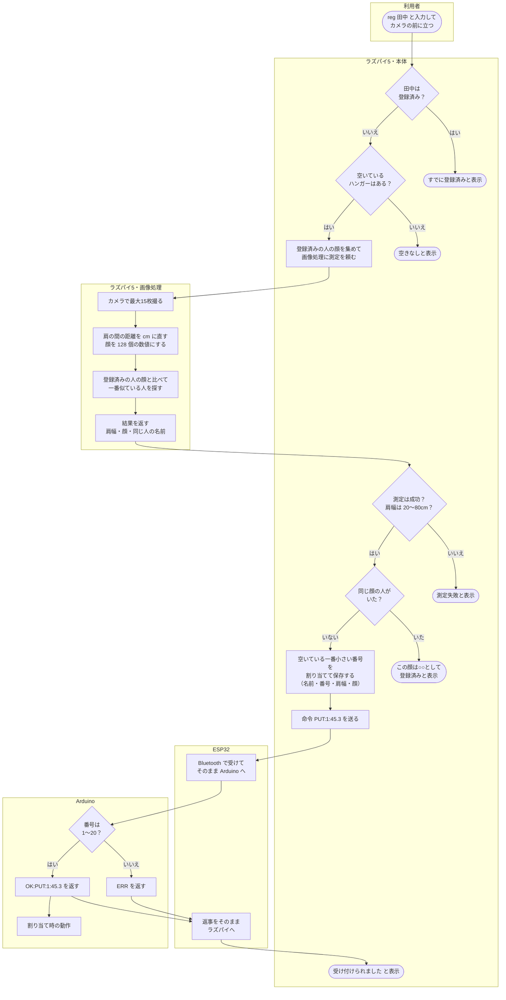
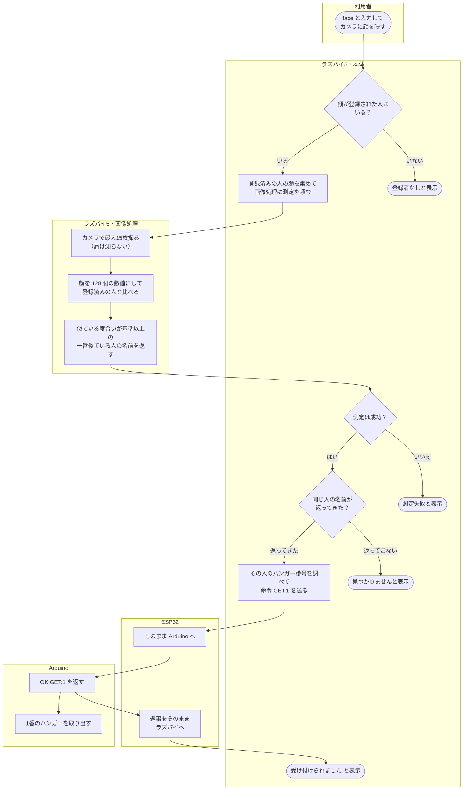

# ハンガー管理システムの流れ

カメラの前に立つと肩幅と顔を測ってハンガーを割り当て、あとから名前か顔でその人のハンガーを機械が取り出します。
この資料では、ラズパイから Arduino まで、命令がどう流れるかを順に追います。

---

## 1. 機器の並び：4つの持ち場と、そのつなぎ方

頭脳はラズパイ5の1台です。その中で「本体」と「画像処理」が分かれて動き、決まった形のデータだけを受け渡します。
ハンガーを動かす命令は、ESP32 を中継して Arduino に届きます。

```
 利用者  ──キーボード・カメラ──▶  ラズパイ5  ──Bluetooth Classic──▶  ESP32  ──配線（UART）──▶  Arduino
```

| 持ち場 | 役割 | すること |
|---|---|---|
| 利用者 | 人 | コマンドを入力し、カメラの前に立つ |
| ラズパイ5・本体（`body/`） | 頭脳 | 登録・検索・削除、保存、機械への命令 |
| ラズパイ5・画像処理（`vision/`） | 頭脳 | カメラ、肩幅の測定、顔の照合 |
| ESP32 | 中継 | 受け取った文字をそのまま Arduino へ流し、返事をそのまま返す |
| Arduino | 手足 | 命令を確かめて返事をし、モーターでハンガーを動かす |

本体と画像処理は、同じラズパイの1つのプログラムの中で動きます。

---

## 2. 登録の流れ：「reg 田中」と入力したとき

本体が画像処理に1回だけ測定を頼みます。画像処理は肩幅と顔を測り、登録済みの人と同じ顔かどうかまで判定して返します。
新しい人なら、本体が空いているハンガーを割り当てて Arduino に知らせます。

ひし形は分かれ道です。



---

## 3. 顔で呼び出す流れ：「face」と入力したとき

登録と同じく、本体は画像処理に1回測定を頼みます。
肩幅は測らず、顔だけで「登録済みの誰か」を判定してもらい、その人のハンガー番号を Arduino に送ります。



---

## 4. カメラを使わないコマンド：名前で呼び出す・消す・一覧

この3つは画像処理を使わず、本体だけで処理します。

| 入力 | ラズパイ（本体）がすること | Arduino に届く命令 |
|---|---|---|
| `get 田中` | 保存した記録から田中のハンガー番号を探す | `GET:1`（1番を取り出す） |
| `del 田中` | 田中の記録を消し、そのハンガーを空きに戻して保存する | なし |
| `list` | 誰がどのハンガーを使っているかを表示する | なし |

---

## 5. 受け渡すもの：境目でやりとりする中身

### 本体 ⇄ 画像処理

本体は関数を1回呼び、画像処理は結果を1つ返します。
顔の数値の中身は画像処理だけが扱い、本体は預かって保存するだけです。

```python
measure(True, {"田中": 顔, …})

→ {"ok": True,
   "face": {"model": "sface-2021dec",
            "v": [0.0019, 0.0283, …]},
   "shoulder_cm": 45.3,
   "match": None}
```

### ラズパイ ⇄ Arduino

1行に1つの短い命令です。ESP32 は中身を読まずに流すので、返事は Arduino から届きます。
返事が来なければ、2回動くのを避けるため送り直しません。

| ラズパイ → Arduino | Arduino → ラズパイ |
|---|---|
| `PING` | `PONG` |
| `PUT:1:45.3` | `OK:PUT:1:45.3` |
| `GET:1` | `OK:GET:1` |
| `GET:25` | `ERR:RANGE:GET:25` |
